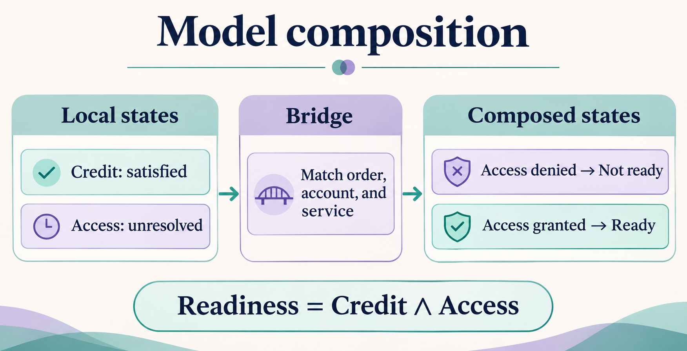

# The Mathematics of Model Composition

An agent can know that an order satisfies a credit policy while another knows that a particular account can access a service. To use both conclusions, a fulfillment agent needs to know how the order, account, and service refer to the same transaction. The mathematics of composition starts with that relationship. It gives us a way to ask which combined states are possible, which conclusions follow from all of them, and what information could settle an open decision. This article develops a constraint-based formulation of the idea in [Agentic Identity and Model Composition](agentic-identity-and-model-composition.md).

## From local models to a composed model

Let $X_i$ be the space of states expressible in domain $i$. For example, a finance state can include an order identifier, a currency, an amount, and a credit limit. Let $A_i \subseteq X_i$ be the states compatible with that domain's current evidence and rules. A state in $A_i$ is a possibility under the model. If the evidence leaves a field unresolved, multiple possible values may remain.

A **bridge** defines which states from different domains can be used together. Write $B \subseteq X_1 \times \cdots \times X_n$ for the tuples that satisfy the bridges. The composed model has this state space:

$$
C = (A_1 \times \cdots \times A_n) \cap B.
$$

The product lists every combination of locally possible states. The bridges keep the combinations that agree on the required relationships. A bridge can express an exact match, such as a shared order identifier, or a relation that needs its own evidence, such as a customer holding an account. It can also connect concepts that play different roles. An approved credit limit in finance satisfies a fulfillment prerequisite only when the amount, currency, scope, and validity match.

Every tuple in $C$ still has a finance component, an access component, and any other source components. A projection $\pi_i$ recovers component $i$. In general, $\pi_i(C) \subseteq A_i$. Other domains can rule out combinations involving a locally possible state, so the set of states visible through the composition can be narrower than the original domain model. Keeping the source models and bridges lets a reviewer see where that narrowing came from.

*Intersection keeps states shared by two models in a common space. Union keeps states allowed by either. A product combines coordinates from different spaces, then constraints select compatible combinations. The wireframe illustrates in three dimensions how a composite can occupy a space with many more coordinates.*

## A $4,800 order

Suppose an order requires $4,800 in credit and finance has approved a $5,000 limit. Fix the order, currency, policy, and time, and assume the approval has been verified for that scope. Let $f$ indicate whether the credit prerequisite holds. The finance claim and its bridge to fulfillment fix $f=1$, since $4{,}800 \le 5{,}000$.

Let $a$ indicate whether service access is authorized for the account and service required by the same order. With no matching access decision in the record, suppose both $a=0$ and $a=1$ are still possible. Let $r$ indicate fulfillment readiness in this simplified example, where credit and access are the only prerequisites. The fulfillment rule is $r=f \land a$. The composed states are:

| Credit $f$ | Access $a$ | Readiness $r$ |
| --- | --- | --- |
| 1 | 0 | 0 |
| 1 | 1 | 1 |

Credit holds in every state. Readiness holds in one state and fails in the other, so the composed model leaves readiness unresolved. If fulfillment requires verified evidence for both prerequisites, it waits for the access decision. A verified authorization that matches the same account and service narrows the composition to the second row. If the order instead rises to $5,200, the stated approval no longer covers it. Then $f=0$ and readiness fails even if access is authorized.

## Conclusions and conflicts

For a statement $P$ about the combined situation, the composed model supports $P$ when $C$ is nonempty and $P$ holds in every state in $C$. If $P$ holds in some states and fails in others, further evidence is needed. In the order example, the access decision is useful because it distinguishes precisely the states in which readiness differs.

If $C$ is empty, there is no state in which all the supplied evidence and bridge constraints hold together. Two records might assign incompatible currencies to what a bridge identifies as the same order, or the bridge itself might link the wrong records. Reporting an empty composition exposes the inconsistency and gives reviewers a reason to inspect the inputs and mappings before making a decision.

The equation describes the semantics of composition. A system can evaluate constraints or join records on demand without materializing the whole product. To make its result inspectable, it can record the identities and versions of the source models, the claims and agents that supplied the evidence, and the bridges used in the inference. When any of them changes, that record identifies which part of the united model needs to be evaluated again.
